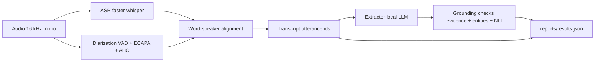

# speech-to-insight

[](https://github.com/hosnahatami04/speech-to-insight/actions/workflows/ci.yml)

From meeting audio to decisions and action items, where every item points back to what was actually said, and errors are traced stage by stage.

A meeting summary that cannot be checked against its source is not trustworthy, and recognition errors travel silently to the final output. This project turns a meeting recording into a transcript, speaker-attributed utterances and extracted decisions and actions where every item cites the utterances it was taken from — and measures how recognition error propagates to the extracted items.

Headline numbers (from [reports/results.json](reports/results.json)): the KPI gate (spec §4) runs on every PR against a committed fixture. Final numbers are reported after a full test-split run with frozen configuration (spec §4, Phase 8). Where a KPI target does not apply (for example per-accent WER needs the publisher's terms accepted first), the field is reported, not concluded from.

This is a personal project on public data. No employer, no customer data, no biometric persistence (speaker embeddings live only in memory).

## Diagram



Each stage sits behind its own typed interface and is cached by (audio hash, model, params), so any stage can be swapped for its reference output and the error contribution of each stage can be measured on its own ([docs/architecture.md](docs/architecture.md)).

## Install (users)

Requires Docker. The compose stack brings up Ollama (pulls the pinned instruct model on first boot), the API and the meeting-viewer UI:

```
docker compose up
```

Then open the meeting viewer at [http://localhost:8501](http://localhost:8501), pick one of the sample meetings (or upload a short clip you have the right to use), and watch the transcript, decisions and action items fill in. Click a decision or action to see the utterances it cites.

Consent: this tool must not be run on a recording of a real meeting without the consent of everyone recorded.

## Install (developers)

Python 3.11 plus [uv](https://github.com/astral-sh/uv). The optional dependency groups let you install only what you need:

```
uv sync --all-extras          # everything
uv run pre-commit install     # pre-commit hooks (ruff, mypy, large-file guard)
make test                     # pytest -m "not ml"
make cov                      # with the 85% coverage gate
make lint typecheck           # ruff + mypy --strict
```

Corpora go under `data/` (gitignored) following the layout in [docs/data.md](docs/data.md). Once they are in place:

```
make data                     # build manifests and reports/data_card.md
uv run speechinsight evaluate-smoke   # KPI smoke gate against the fixture
```

Benchmarks live under [benchmarks/](benchmarks/) and reports under [reports/](reports/).

Project layout: `src/speechinsight/` holds the package (audio, asr, diarize, extract, evaluation, service, ui). `configs/` carries the pinned model and corpus identities. `docs/decisions/` carries the ADRs — read ADR 0002 first.

## Contributor expectations

- Branch per phase (`phase-N/short-name`), Conventional Commits (feat/fix/docs/test/ci/chore/perf/refactor/build with a scope), one PR per phase, merge commit (not squash) on main.
- `make test` and `make cov` must pass locally; CI enforces the coverage gate and the KPI smoke gate.
- Record every non-trivial design decision as an ADR under [docs/decisions/](docs/decisions/).
- Never tune anything on the test split. Thresholds come from dev only.
- No audio that is not freely licensed. Speaker embeddings must not reach cache, output or disk.
- Every WER carries the normalizer name (`speechinsight-v1`); every DER carries the collar and overlap policy.

## Known issues

- English only.
- The AMI subset is small (3 dev + 3 test meetings) because of the CPU time budget; see ADR 0003. Scaling the subset is a config change at a known cost.
- AMI scenario meetings are acted — participants play a product-design team, not a real meeting. Called out in the data card.
- The diarizer is intentionally simple (VAD → ECAPA → agglomerative clustering) and struggles with heavily overlapping speech. See ADR 0006.
- Matching extracted items against AMI reference summaries is automatic and approximate (cosine similarity + Hungarian assignment); borderline pairs are flagged for human review (ADR 0007).
- Synthetic transcript corruption does not match the error distribution of a real recognizer; the real-ASR points on the degradation plot show the gap (ADR 0008).
- Extraction runs on CPU and is slow for long meetings.
- Any KPI that did not reach its spec §4 target is reported as such, not quietly dropped.
