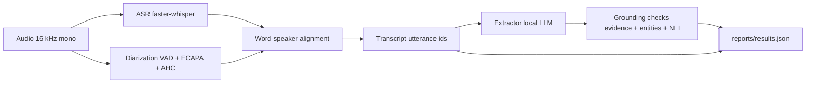

# speech-to-insight

[](https://github.com/hosnahatami04/speech-to-insight/actions/workflows/ci.yml)

From meeting audio to decisions and action items, where every item points back to what was actually said, and errors are traced stage by stage.

## Pipeline



Each stage sits behind its own typed interface and is cached by (audio hash, model, params), so any stage can be swapped for its reference output and the error contribution of each stage can be measured on its own ([docs/architecture.md](docs/architecture.md)).

## Usage

Requires Docker.

```
docker compose up
```

Open the meeting viewer at [http://localhost:8501](http://localhost:8501), upload a short audio clip you have the right to use, and watch the transcript, decisions and action items fill in. Click a decision or action to see the utterances it cites.

Consent: do not run this on a recording of a real meeting without the consent of everyone recorded.

## Notes

- English only.
- Speaker embeddings live only in memory — never cached, never written to disk.
- Extraction runs on CPU; long meetings take proportionally longer.
- The AMI subset is small (3 dev + 3 test meetings) because of the CPU budget — see ADR 0003.
- The diarizer is intentionally simple and struggles with heavily overlapping speech — see ADR 0006.
