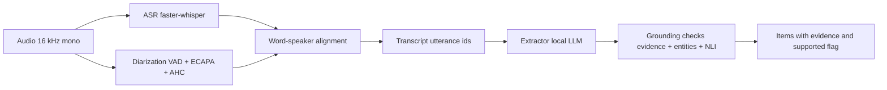

# Architecture

Three independent stages tied together by one intermediate structure — the
`Transcript` — so each stage can be evaluated on its own and swapped for the
reference output to isolate where errors come from.

## Pipeline

## The shared Transcript

`Transcript` is a tuple of `Utterance(id, speaker, start, end, text, words)`.
Utterance ids are stable (`u0001`, `u0002`, ...). Every stage after
recognition consumes and produces only this structure. Extracted items cite
utterance ids as `evidence`, so a reader can always trace an item back to the
words it was taken from.

## Why not a packaged pipeline

A single packaged pipeline (for example a turnkey diarization pipeline or an
LLM orchestration framework) hides stage boundaries. The project is
specifically about measuring error at each boundary, so each stage is behind
its own interface:

- `asr.base.Transcriber`: audio -> words with timestamps.
- `diarize.vad.SileroVad` + `diarize.embed.EcapaEmbedder` +
  `diarize.cluster`: audio -> speaker segments.
- `diarize.align.build_transcript`: words + segments -> `Transcript`.
- `extract.run.extract`: `Transcript` -> grounded items.

Any stage can be replaced by its reference output in the propagation study
(ADR 0008) so the error contribution of the other stages is measured
independently.

## Caching

Each stage is content-addressed by `(audio_hash, stage, model, params)`.
Repeating a sweep does not re-transcribe. Speaker embeddings are **not**
cached — they are biometric data (spec §1.2) and live only on the `Window`
object for the duration of a run.

## Reproducibility

- faster-whisper runs with beam search and temperature 0.
- Silero VAD and agglomerative clustering are deterministic.
- The local LLM runs with temperature 0 and a fixed seed.
- Synthetic noise and transcript corruption carry a seed.

Every pinned model identity and the extractor digest travel with every
report (`model_pins` in results.json) alongside the normalizer name for every
WER and the collar + overlap policy for every DER.

## Evaluation and KPI gate

- Per-stage metrics: WER (`evaluation.wer`), DER (`evaluation.der`),
  extraction KPIs (`evaluation.gate`).
- Robustness: controlled noise (`audio.noise` + `evaluation.noise_sweep`),
  per-accent WER (`evaluation.accents`).
- Error propagation: controlled transcript corruption
  (`evaluation.propagation`), stage attribution
  (`evaluation.attribution`), degradation fit.
- Reporting: `evaluation.report` writes `reports/results.json` and
  `reports/results.md`.
- KPI gate: `evaluation.gate.check_file` validates a results.json against
  the thresholds in spec §4. CI runs it against a committed smoke fixture
  on every PR.

## ADRs

The architecture decisions are recorded in [decisions/](decisions/). Start
with ADR 0001 (how we record decisions) and ADR 0002 (scaffold and the
shared `Transcript`).
